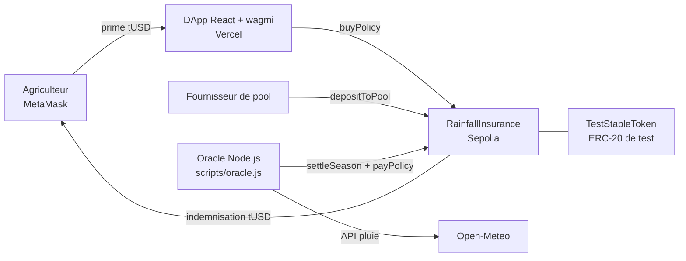

# Micro-assurance agricole paramétrique indexée sur la pluviométrie

Projet du cours de **Blockchain et cryptomonnaies** (Master 1, mention Mathématiques, Statistiques et Informatique, Faculté des Sciences et Technologies, Université de Kinshasa).
**Groupe 37 : DApp et finance décentralisée.**

> ⚠️ Prototype académique. Réseau de test **Ethereum Sepolia** uniquement, jetons sans valeur réelle.

## Membres du groupe

| N° | Nom |
|----|-----|
| 1 | LUNGA KULENGA Jacky |
| 2 | LWAULA SOKI Divin |
| 3 | MAKOSI BORSON Exauce |
| 4 | MANDANGI LUKOMBO Roldy |

## Liens à vérifier

| Livrable | Lien |
|----------|------|
| DApp déployée (Vercel) | https://micro-assurance-pluie.vercel.app/ |
| Dépôt GitHub | https://github.com/exauceMAKOSI/Micro-assurance-pluie |
| Contrat `RainfallInsurance` | [0x2d9bDc40af88033fcA7c9bECa4c5A2d69b071027](https://sepolia.etherscan.io/address/0x2d9bDc40af88033fcA7c9bECa4c5A2d69b071027#code) |
| Contrat `TestStableToken` | [0x45b15060F63685BE949E9e718a19905E58F30c75](https://sepolia.etherscan.io/address/0x45b15060F63685BE949E9e718a19905E58F30c75#code) |

Le code source des deux contrats est **vérifié** sur Etherscan (réseau Sepolia).

## 1. Objectifs

Un agriculteur souscrit une police pour une zone et une saison, en payant une prime en jeton stable de test. Un oracle récupère la pluie observée. Si elle est trop faible (**sécheresse**) ou trop forte (**inondation**) selon des seuils fixés, l'indemnisation est versée **automatiquement**, sans déclaration de sinistre. Les indemnisations sont garanties par un **pool de réassurance**. Un tableau de bord affiche les polices et leur état.

### Règles du prototype

| Paramètre | Valeur |
|-----------|--------|
| Zone | Kinshasa (une seule zone) |
| Prime | 10 tUSD (fixe) |
| Indemnisation | 100 tUSD (fixe) |
| Sécheresse | pluie cumulée **< 20 mm** |
| Inondation | pluie cumulée **> 200 mm** |
| Pluie normale | de 20 à 200 mm inclus : aucun paiement |
| Saison de démonstration | 90 secondes (durée réglable à la création) |

## 2. Architecture



### Sur la chaîne (Sepolia)
- **`TestStableToken`** : jeton ERC-20 de test (`tUSD`, 18 décimales) avec une fonction `faucet()` qui distribue 1000 tUSD à qui le demande. Il ne sert qu'aux tests.
- **`RainfallInsurance`** : saisons, polices, pool de réassurance, règlement par l'oracle, indemnisation.
  - Rôles (OpenZeppelin `AccessControl`) : `DEFAULT_ADMIN_ROLE` (démarre les saisons), `ORACLE_ROLE` (déclare la pluie).
  - Fonctions principales : `startSeason`, `buyPolicy`, `depositToPool`, `withdrawFromPool`, `settleSeason`, `payPolicy`.
  - Événements pour la traçabilité : `SeasonStarted`, `PolicyCreated`, `SeasonSettled`, `PayoutTriggered`, `PolicyClosedNoPayout`, `PoolDeposit`, `PoolWithdrawal`.

### Hors chaîne
- **Oracle** (`scripts/oracle.js`, Node.js) : interroge l'API **Open-Meteo** (pluie cumulée sur 30 jours pour Kinshasa), appelle `settleSeason` quand la saison est terminée, puis `payPolicy` pour chaque police. Il tourne en boucle (vérification toutes les 30 s) et utilise l'heure de la blockchain.
- **DApp** (`dapp/`) : React + Vite + wagmi + viem. Connexion MetaMask, souscription, suivi des polices, pool, panneau de démonstration.

### Note sur Chainlink
L'énoncé prévoyait Chainlink Functions et Chainlink Automation. Ces services sont **dépréciés par Chainlink** (arrêt en juin 2026 sur les réseaux de test), et remplacés par **Chainlink CRE**. Nous avons donc réalisé l'oracle et l'automatisation par un script d'oracle équivalent. Le contrat n'est pas lié à l'oracle : il suffit d'accorder `ORACLE_ROLE` à un autre compte ou contrat (par exemple un workflow CRE) pour changer de source.

## 3. Installation

Prérequis : Node.js (LTS), Git, MetaMask.

```bash
git clone https://github.com/exauceMAKOSI/Micro-assurance-pluie.git
cd Micro-assurance-pluie
npm install
```

Créer un fichier `.env` à la racine (jamais publié sur GitHub) :

```
SEPOLIA_RPC_URL=https://eth-sepolia.g.alchemy.com/v2/VOTRE_CLE
ETHERSCAN_API_KEY=VOTRE_CLE_ETHERSCAN
PRIVATE_KEY=CLE_PRIVEE_DU_PORTEFEUILLE_DE_TEST_SANS_0x
```

> Utiliser **uniquement** un portefeuille dédié au projet, sans fonds réels.

## 4. Tests et sécurité

```bash
npx hardhat test
```

**9 tests automatisés** : souscription, indemnisation en cas de sécheresse, d'inondation, pluie normale, seuils exacts (20 et 200 mm), règlement refusé à un non-oracle, règlement refusé avant la fin de saison, refus du double paiement, retrait impossible des fonds réservés.

**Analyse statique** avec Slither (rapport complet : [`slither-rapport.md`](slither-rapport.md)) :

```bash
pip install slither-analyzer
slither . --filter-paths "node_modules"
```

Résultat : **3 alertes de faible gravité**, toutes de type « usage de `block.timestamp` dans des comparaisons » (`buyPolicy`, `settleSeason`, `payPolicy`). Risque accepté : un validateur peut décaler l'heure d'un bloc de quelques secondes, ce qui est négligeable face à des saisons de plusieurs semaines. Aucune alerte de réentrance, de contrôle d'accès ou de transfert non vérifié.

### Bonnes pratiques appliquées
- **Contrôle d'accès** : `AccessControl` (administrateur, oracle).
- **Protection contre la réentrance** : `ReentrancyGuard` sur toutes les fonctions qui déplacent des jetons, et mise à jour de l'état avant le transfert.
- **Transferts sûrs** : `SafeERC20`.
- **Validation des entrées** : montants non nuls, saison et police existantes, saison non réglée.
- **Solvabilité** : une police n'est vendue que si le pool couvre toutes les indemnisations déjà promises (`reservedPayouts`), et les fonds réservés ne peuvent pas être retirés.
- **Traçabilité** : événements pour chaque opération.
- **Aucun secret publié** : variables d'environnement exclues de GitHub, portefeuille dédié aux tests.

## 5. Déploiement

```bash
npx hardhat run scripts/deploy.js --network sepolia
npx hardhat verify --network sepolia ADRESSE_TOKEN
npx hardhat verify --network sepolia ADRESSE_ASSURANCE ADRESSE_TOKEN ADRESSE_ADMIN ADRESSE_ORACLE
```

**DApp** : dossier `dapp/` déployé sur **Vercel** (répertoire racine `dapp`, préréglage Vite).

```bash
cd dapp
npm install
npm run dev
```

## 6. Démonstration

1. Ouvrir la DApp, connecter MetaMask (réseau Sepolia, accepter le changement de réseau).
2. Cliquer sur **« Recevoir 1000 tUSD de test »**.
3. Avec le compte administrateur, **démarrer une saison de 90 s**, puis **souscrire** une police.
4. Lancer l'oracle dans un terminal :
   ```bash
   npx hardhat run scripts/oracle.js --network sepolia
   ```
5. À la fin de la saison, l'oracle déclare la pluie et déclenche le paiement automatiquement. La police passe à « Indemnisée » ou « Clôturée sans indemnisation ».

**Résultats obtenus sur Sepolia**

| Scénario | Pluie | Résultat |
|----------|-------|----------|
| Données réelles Open-Meteo (Kinshasa, 30 jours) | 115 mm | Police clôturée sans indemnisation |
| Simulation de sécheresse (`RAIN_OVERRIDE=10`) | 10 mm | Indemnisation automatique de 100 tUSD |

Mode simulation (pour la démonstration) :

```powershell
$env:RAIN_OVERRIDE="10"
npx hardhat run scripts/oracle.js --network sepolia
```

**Comptes de démonstration** : l'administrateur et l'oracle sont le portefeuille de test du déployeur `0xfA603518B13F43e028f8a63375fc2361f7A98e27`. Tout autre portefeuille peut souscrire une police après avoir utilisé le faucet du jeton.

### Captures d'écran

| | |
|---|---|
| Tableau de bord de la DApp | `docs/dapp-tableau-de-bord.png` |
| Police indemnisée | `docs/police-indemnisee.png` |
| Oracle dans le terminal | `docs/oracle-terminal.png` |
| Contrat vérifié sur Etherscan | `docs/etherscan-verifie.png` |

## 7. Tokenomics

- **`tUSD`** : jeton stable **de test**, sans valeur, émis par le contrat. Offre initiale de 1 000 000 tUSD au déployeur. La fonction `faucet()` en crée 1000 à chaque appel (acceptable uniquement en test).
- **Flux** : la prime (10 tUSD) entre dans le pool ; l'indemnisation (100 tUSD) en sort ; les fournisseurs de liquidité déposent et retirent dans la limite des fonds non réservés.
- **Équilibre** : le pool gagne les primes des polices sans sinistre et paie 100 tUSD par police indemnisée. Le prototype n'a pas de tarification actuarielle ; en production, la prime se calculerait d'après la probabilité historique de sécheresse ou d'inondation.
- Aucune levée de fonds, vente de jetons, promesse de rendement ni mécanisme de Ponzi.

## 8. Coûts en gas

Mesurés sur une blockchain locale avec `scripts/gas.js` (valeur en ETH calculée à **10 gwei**, à titre indicatif).

| Fonction | Gas | Coût à 10 gwei (ETH) |
|----------|-----|----------------------|
| Déploiement `RainfallInsurance` | 2 341 503 | 0,02341503 |
| `faucet()` | 50 904 | 0,00050904 |
| `approve()` | 46 964 | 0,00046964 |
| `depositToPool()` | 87 898 | 0,00087898 |
| `startSeason()` | 76 187 | 0,00076187 |
| `buyPolicy()` | 129 173 | 0,00129173 |
| `settleSeason()` | 75 058 | 0,00075058 |
| `payPolicy()` (avec indemnisation) | 78 755 | 0,00078755 |
| `withdrawFromPool()` | 51 823 | 0,00051823 |

Pour un agriculteur, une souscription coûte donc environ **176 000 gas** (autorisation + `buyPolicy`), et l'indemnisation est déclenchée par l'oracle, sans frais pour lui.

## 9. Menaces et mesures

| Menace | Mesure |
|--------|--------|
| Réentrance lors des transferts | `ReentrancyGuard`, état mis à jour avant le transfert |
| Double indemnisation | Drapeau `resolved` par police |
| Règlement frauduleux de la saison | Seul `ORACLE_ROLE` peut déclarer la pluie |
| Insolvabilité du pool | `reservedPayouts` et contrôle à la souscription |
| Retrait des fonds promis | `withdrawFromPool` limité aux fonds non réservés |
| Manipulation de l'heure du bloc | Impact faible (quelques secondes), signalé par Slither |
| Fuite de secrets | `.env` exclu de GitHub, portefeuille dédié, clés régénérables |

## 10. Limites

- **Oracle centralisé** : un seul compte déclare la pluie. C'est le principal point de confiance du prototype.
- **Source de données unique** (Open-Meteo), sans recoupement.
- **Fenêtre de pluie fixe** de 30 jours, indépendante de la durée réelle de la saison (la saison de 90 s est un réglage de démonstration).
- **Souscription ouverte jusqu'à la fin de la saison** : un assuré pourrait souscrire tard, en connaissant déjà une partie de la pluie. À restreindre en production.
- **Une seule zone**, prime et indemnisation fixes, pas de tarification actuarielle.
- **Faucet de jeton illimité**, réservé aux tests.
- Pas d'audit externe.

## 11. Feuille de route vers la production

1. Remplacer l'oracle par un **workflow Chainlink CRE** (successeur de Functions et Automation) avec plusieurs sources de données.
2. Plusieurs zones et saisons réelles (calendrier agricole), seuils par zone.
3. Tarification actuarielle de la prime à partir de données historiques.
4. Restriction de la fenêtre de souscription (avant le début de saison).
5. Gouvernance et gestion du pool (multisignature, plafonds, rendement des fournisseurs).
6. **Audit de sécurité externe**, tests de propriétés, puis déploiement sur un réseau principal avec un vrai stablecoin.
7. Intégration mobile et paiements mobiles locaux.

## 12. Dépendances et références

- [OpenZeppelin Contracts](https://github.com/OpenZeppelin/openzeppelin-contracts) : `ERC20`, `AccessControl`, `ReentrancyGuard`, `SafeERC20`
- [Hardhat](https://hardhat.org) et `@nomicfoundation/hardhat-toolbox` : compilation, tests, déploiement, vérification
- [ethers](https://docs.ethers.org/) (via Hardhat), Chai
- [Slither](https://github.com/crytic/slither) : analyse statique
- [React](https://react.dev), [Vite](https://vite.dev), [wagmi](https://wagmi.sh), [viem](https://viem.sh), [TanStack Query](https://tanstack.com/query)
- [Open-Meteo](https://open-meteo.com) : données météo (API gratuite)
- [Alchemy](https://www.alchemy.com) : accès RPC Sepolia ; [Etherscan](https://etherscan.io) : explorateur
- [Chainlink](https://chain.link) : faucet de test ; référence à CRE pour l'évolution
- Vercel : hébergement de la DApp

**Modèles d'IA** : le fonctionnement du prototype n'utilise aucun modèle d'IA. En développement, l'assistant **Claude (Anthropic)** a été utilisé comme aide à la programmation et à la rédaction ; tout le code a été exécuté, testé et déployé par l'équipe.

## Licence

MIT, usage académique.